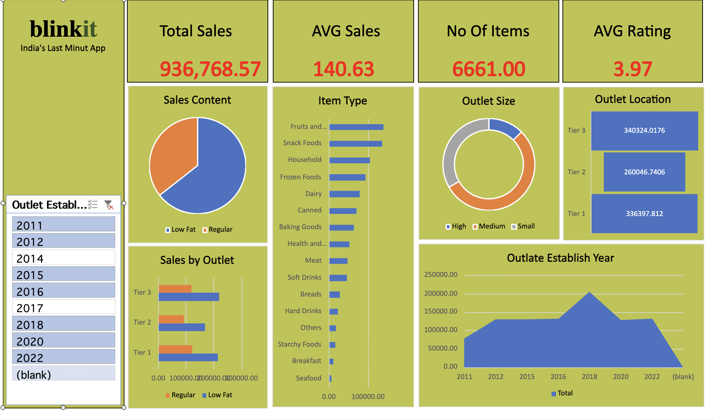

# Blinkit Grocery Data Analysis Dashboard

## Project Overview

This project analyzes Blinkit's grocery sales data through an interactive dashboard. The dashboard summarizes sales performance and helps explore how sales vary by fat content, item type, outlet size, outlet location tier, and outlet establishment year.

The goal is to turn raw sales data into clear, useful business insights that can support data-driven decision-making.

## Dashboard Preview



> **Note:** Upload your dashboard screenshot to the GitHub repository (for example, in an `images` folder) and update the image path above if you store it in a different location.

## Key Performance Indicators (KPIs)

The dashboard highlights these headline metrics:

| KPI | Displayed Value | Description |
|---|---:|---|
| Total Sales | 1,201,681.49 | Total sales revenue represented in the current dashboard view |
| Average Sales | 140.99 | Average sales value calculated by the dashboard |
| Number of Items | 8,523.00 | Item count represented by the dashboard measure |
| Average Rating | 3.97 | Average customer rating |

*Values reflect the current dashboard view and may change when filters are applied.*

## Dashboard Analysis

The dashboard includes the following visualizations:

- **Sales by Fat Content:** Compares total sales for Low Fat and Regular products.
- **Sales by Item Type:** Compares sales across grocery categories, such as Fruits and Vegetables, Snack Foods, Household, Frozen Foods, and Dairy.
- **Sales by Outlet Size:** Shows the sales distribution across High, Medium, and Small outlet sizes.
- **Sales by Outlet Location:** Compares total sales across Tier 1, Tier 2, and Tier 3 locations.
- **Sales by Outlet:** Compares Low Fat and Regular product sales across outlet location tiers.
- **Outlet Establishment Year:** Shows how sales vary by outlet establishment year.
- **Outlet Establishment Year Filter:** Lets users filter the dashboard by selected establishment years.

### 1. Sales by Fat Content
A pie chart compares sales for **Low Fat** and **Regular** products. In the current view, Low Fat products account for the larger share of sales.

### 2. Sales by Item Type
A horizontal bar chart compares total sales across grocery categories, including Fruits and Vegetables, Snack Foods, Household, Frozen Foods, Dairy, Canned products, and other item types. Fruits and Vegetables and Snack Foods are among the leading categories in the displayed chart.

### 3. Sales by Outlet Size
A doughnut chart compares sales contribution from **High**, **Medium**, and **Small** outlets. Medium outlets have the largest share in the current view.

### 4. Sales by Outlet Location
A bar-style visual compares sales across **Tier 1**, **Tier 2**, and **Tier 3** outlet locations.

| Outlet Location | Sales |
|---|---:|
| Tier 3 | 472,133.03 |
| Tier 2 | 393,150.65 |
| Tier 1 | 336,397.81 |

Tier 3 has the highest displayed sales among the three location tiers.

### 5. Sales by Outlet
A clustered horizontal bar chart compares Low Fat and Regular product sales across Tier 1, Tier 2, and Tier 3 outlets.

### 6. Outlet Establishment Year
An area chart shows sales across outlet establishment years. In the current view, the chart reaches its highest point around **2018**.

### 7. Outlet Establishment Year Filter
A slicer allows users to select establishment years and interactively filter the dashboard.
## Tools & Skills

- **Microsoft Excel** — data inspection and preparation (where applicable)
- **Excel** — dashboard design, KPI cards, charts, and interactive filtering
- **Data Analysis** — comparing categories and identifying sales patterns
- **Data Visualization** — presenting results in a clear, interactive format

> Keep only the tools and tasks you actually used in your project.

## Key Observations

Based on the dashboard's current view:

- Total sales are approximately **936.77K**.
- **Low Fat** products contribute a larger share of sales than Regular products in the fat-content chart.
- **Fruits and Vegetables** and **Snack Foods** are among the leading item types by sales.
- **Tier 3** outlets show the highest total sales among the three outlet location tiers in the displayed chart.
- The outlet-size chart indicates that **Medium** outlets account for the largest share of sales in the current view.
- Sales vary across outlet establishment years, with a visible peak around **2018** in the displayed trend.

These observations describe the screenshot's current filter selection and should be validated against the full dataset before being used as formal business conclusions.

## Business Value

This analysis can help stakeholders:

- Compare sales performance across product categories.
- Understand the contribution of product fat-content groups.
- Compare outlet performance by size and location tier.
- Review sales patterns by outlet establishment year.
- Use interactive filters to explore specific periods and categories.

## Repository Structure

A suggested GitHub repository layout:

```text
Blinkit-Grocery-Data-Analysis/
├── README.md
├── BlinkIT-Grocery-Data-Analysis.xlsx
├── Dashboard-Screenshort.png
└── Blinkit-Grocery-Data-Analysis.pbix   # Add if you have a Power BI file
```

Rename `Dashboard-Screenshort.png` to `dashboard-screenshot.png` if you prefer a more standard filename, and update the image path in this README accordingly.


## Project Purpose

This project demonstrates practical data-analysis and dashboarding skills, including KPI reporting, category comparisons, interactive filtering, and communicating findings through visualizations.

